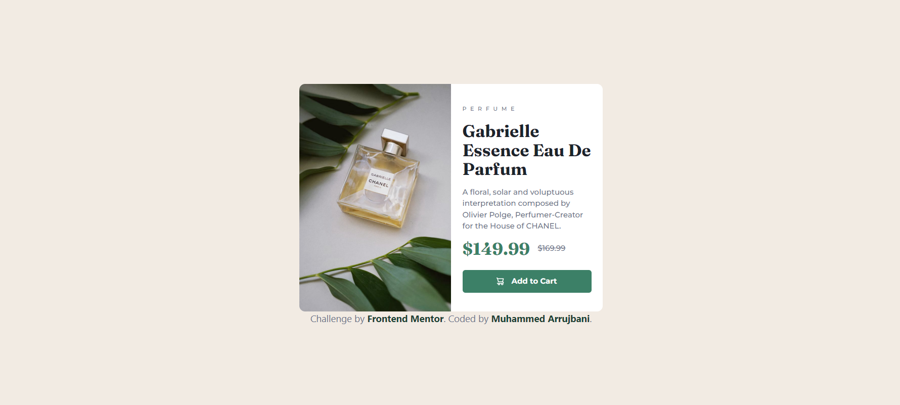

# Frontend Mentor - Product preview card component solution

This is a solution to the [Product preview card component challenge on Frontend Mentor](https://www.frontendmentor.io/challenges/product-preview-card-component-GO7UmttRfa). Frontend Mentor challenges help you improve your coding skills by building realistic projects.

## Table of contents

- [Overview](#overview)
  - [The challenge](#the-challenge)
  - [Screenshot](#screenshot)
  - [Links](#links)
- [My process](#my-process)
  - [Built with](#built-with)
  - [What I learned](#what-i-learned)
  - [Continued development](#continued-development)
  - [Useful resources](#useful-resources)
- [Author](#author)

## Overview

### The challenge

Users should be able to:

- View the optimal layout depending on their device's screen size
- See hover and focus states for interactive elements

### Screenshot



### Links

- Solution URL: [Front-End Mentor](https://your-solution-url.com)
- Live Site URL: [Front-End Mentor](https://your-live-site-url.com)

## My process

### Built with

- Semantic HTML5 markup
- CSS custom properties
- CSS Grid
- Mobile-first workflow
- Tailwind Css

### What I learned

#### Using Tailwind css to make the entair design.

```html
<button
  class="w-full my-4 p-3 cursor-pointer border-none outline-none rounded-md bg-[var(--Green-500)] text-[var(--White)] font-[Montserrat] font-[var(--fw-mont-700)] flex justify-center items-center transition duration-300 lineare hover:bg-[var(--Green-700)]"
>
  
  Add to Cart
</button>
```

#### Make a clean and organized css variables environment.

```css
:root {
  /* ### Primary ### */
  --Green-500: rgb(60, 128, 103);
  --Green-700: rgb(27, 65, 51);
  /* ### Neutral ### */
  --Black: rgb(28, 35, 43);
  --Grey: rgb(108, 114, 137);
  --Cream: rgb(242, 235, 227);
  --White: rgb(255, 255, 255);
  /* ### Font size,weight ### */
  --fs-paragraph: 14px;
  --fw-mont-500: 500;
  --fw-mont-700: 700;
  --fw-fran-700: 700;
}
```

### Useful resources

- [Tailwind Css Docs](https://tailwindcss.com/docs/installation/using-vite) - This helped me for looking up for all the utility classes needed. I really liked this pattern and will use it going forward.

## Author

- Website - [Github repo](https://github.com/MoMo97X/Product-Review-Card-Component)
- Frontend Mentor - [@MoMo97X](https://www.frontendmentor.io/profile/MoMo97X)
